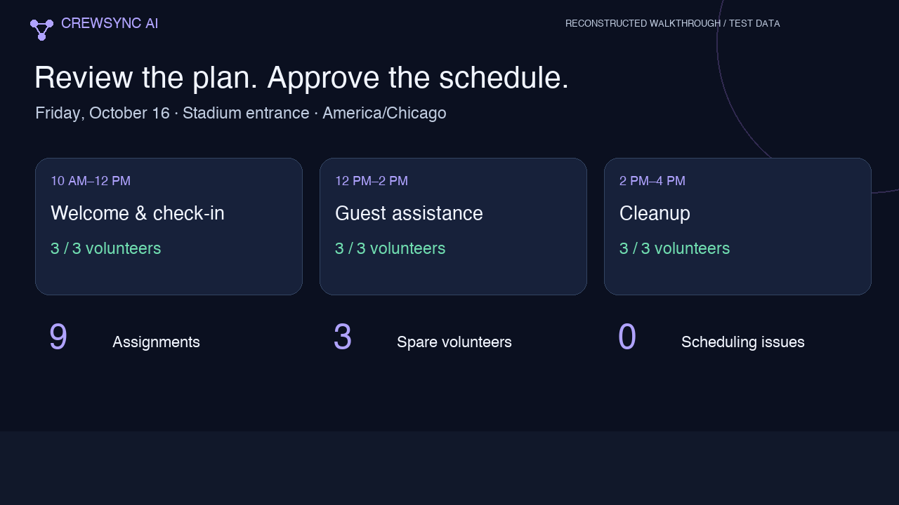
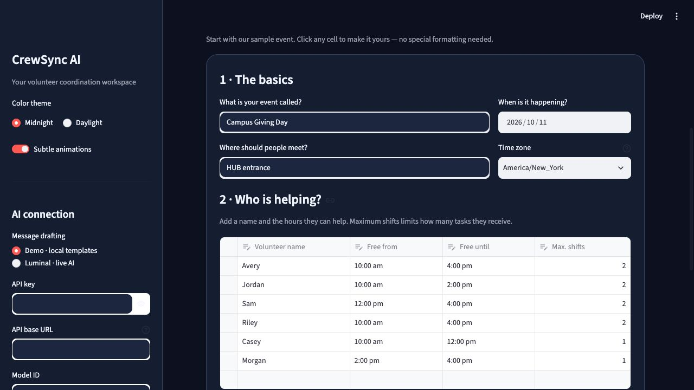
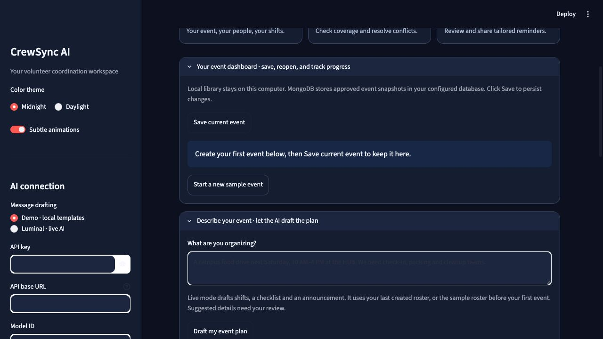
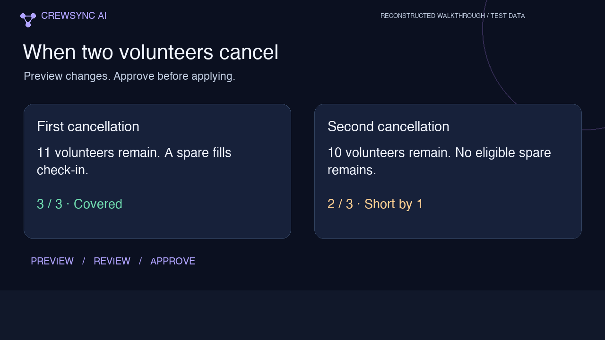

# CrewSync AI
### You lead. We coordinate.

**Turn volunteer availability into a clear event plan—and handle the changes when someone cancels.**

Built for student clubs, THON committees, and volunteer coordinators organizing one-day events. CrewSync combines availability-aware scheduling with AI-assisted planning and communication, while keeping coordinators in control.

[▶ Watch the one-minute narrated explainer](media/crewsync-demo.mp4) · [Demo script](DEMO.md) · [Test scenarios](TESTING.md) · [Setup guide](docs/SETUP.md)

[](media/crewsync-demo.mp4)

*The video is a reconstructed walkthrough of the fictional Chicago football test: the full 12-person roster, prompt entry, three covered shifts, cancellation recovery, drafts, saving, hard checks, and a Mumbai example. It includes simple English narration and captions. The owner confirmed a successful live Luminal run; this video is not a continuous recording of that run.*

## The problem

Volunteer availability is scattered across messages and spreadsheets. A coordinator has to fill shifts, check conflicts, track preparation, and explain every change to the team. A last-minute cancellation can mean doing that work again.

## The workflow

1. **Add your people:** names, available hours, and maximum shifts in editable tables.
2. **Plan the event:** enter shifts directly, or ask a configured Luminal model to propose an event plan.
3. **Review and approve:** check the date, place, suggested shifts, tasks, and announcement.
4. **Coordinate:** view coverage, assign checklist tasks, and track completion.
5. **Adapt:** preview a cancellation, review replacement assignments, then approve.
6. **Communicate:** draft reminders and requests for help; review before sharing.

### A beginner-friendly setup



### A coordination workspace



### A cancellation example



*Illustrative fixture: 12 volunteers, three shifts, three people per shift. The first cancellation is covered by a spare. A second cancellation in the same shift leaves an honest shortage of one.*

## What is working

| Feature | Behavior |
|---|---|
| Scheduling | Assigns available volunteers without overlapping shifts or exceeding workload limits |
| Conflict checks | Flags availability violations, overlaps, duplicate assignments and staffing gaps |
| AI event planning | Configured Luminal Chat Completions generates a validated, editable proposal |
| Task management | Assign responsibility, set due dates, and track completed work |
| Cancellation recovery | Preview changes and approve before applying them |
| Communications | Generate briefings, announcements and reminder drafts; no automatic sending |
| Saving | Local persistence on the developer's computer; isolated session records in hosted demo mode |
| Appearance | Light/dark themes, readable contrast, motion controls and captions in the explainer |

**MongoDB is optional and has not been used for this demonstration.** The Atlas adapter is implemented and its request contract is mock-tested. We do not claim a verified Atlas connection, MongoDB-backed demo, or MongoDB track qualification.

Demo mode works without any credentials. Its event creator uses a fixed sample fixture and its messages use local templates. Live mode is explicitly labeled and requires a working Luminal key and available credits. AI output must be reviewed.

## Run locally

Requires Python 3.10+.

```sh
python3 -m venv .venv
source .venv/bin/activate
python -m pip install -r requirements.txt
python -m streamlit run app.py
```

Windows activation: `.venv\Scripts\activate`. Open the URL printed by Streamlit.

For live AI, enter the key in **Private AI settings**, or copy `.env.example` to `.env` and configure it there. The non-secret settings confirmed in the supplied Luminal dashboard are:

```dotenv
LUMINAL_BASE_URL=https://flash.luminal.cloud/v1
LUMINAL_MODEL=deepseek-ai/DeepSeek-V4.1-Flash
```

**Keep API keys and database passwords out of Git.** `.env`, other environment files, Streamlit secrets, and saved local records are ignored. Collapse the credential panel before recording.

## Deployment

Deploy the existing Python app on [Streamlit Community Cloud](https://share.streamlit.io):

- Repository: `palashDoshi1/CrewSync`
- Branch: `main`
- Entry point: `app.py`
- Python: `3.12`
- In Advanced settings → Secrets, set `CREWSYNC_PUBLIC_DEMO = "true"`.

Hosted demo mode uses a separate event library for each visitor's session and does not use MongoDB. Records disappear when a session ends. Visitors can try local templates without a key, or enter their own Luminal key for live requests. A server-stored key is not displayed in the hosted key field. Do not publish real participant records.

The repository can stay private; provide access if judges need to inspect the source. Set the deployed app's visibility as required by the submission. [Official deployment instructions](https://docs.streamlit.io/deploy/streamlit-community-cloud/deploy-your-app).

## Verification

```sh
python -m unittest discover -v
python tests/workflow_check.py
```

GitHub Actions runs these checks on every push. The suite covers Chicago/Mumbai schedules, coverage, cancellation replacement, unresolved shortages, overlaps, workload limits, valid AI proposal schemas, saved-event recovery and the coordinator approval workflow. AI and Atlas protocol checks use mock services. Use [TESTING.md](TESTING.md) to perform live Luminal checks.

## Practical limits

Same-day volunteer events only. The scheduler is greedy and does not prove an optimal arrangement. Skills, payroll, employee scheduling rules and multi-day events are outside this MVP. AI drafts do not confirm attendance or send messages. Public production use needs authentication and organization-level access controls.

**Pitch:** “CrewSync helps volunteer coordinators plan an event, recover from cancellations, and prepare clear communication in one reviewed workflow.”
